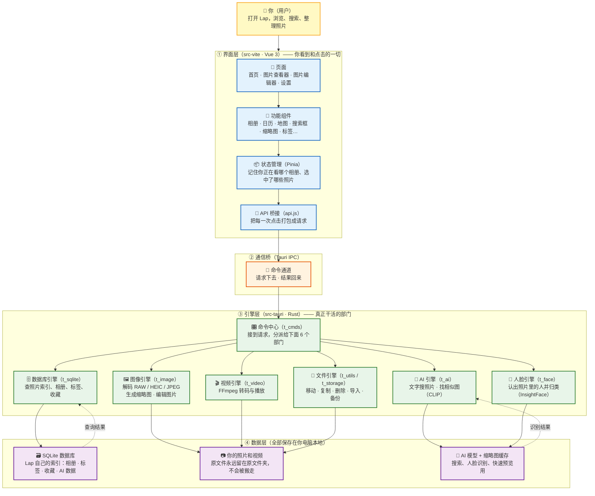

# Lumi 项目架构图

> **Lumi** 是一个开源、本地优先的桌面照片管理器（macOS / Windows / Linux），
> 基于 [Lap](https://github.com/julyx10/lap) 二次开发。原作者 julyx10，本 fork 维护者 liuyihua2015。
> 你的照片永远留在自己的硬盘上，AI 搜索、人脸识别都在本机运行，无需上传云端。

## 一图看懂（Mermaid）



## 逐层解释（完全不懂代码也能懂）

| 层 | 是什么 | 打个比方 |
| :-- | :-- | :-- |
| ① 界面层 | 用 Vue 3 写的桌面窗口，包含首页、图片查看器、编辑器、设置等页面 | **餐厅的菜单和前台**：你点菜、看到菜品 |
| ② 通信桥 | Tauri 提供的"命令通道"，界面和引擎之间传话 | **服务员**：把你的需求端进厨房，再把菜端出来 |
| ③ 引擎层 | 用 Rust 写的 6 个功能部门：数据库、图像、视频、AI、人脸、文件管理 | **厨房里的各个厨师**：各管一摊，配合出菜 |
| ④ 数据层 | 三类本地数据：SQLite 索引库、你的照片原文件、AI 模型与缩略图缓存 | **仓库和冰箱**：食材和调料都放在自己家，不送外卖 |

## 一次点击发生了什么？（数据流示例）

> 你在搜索框输入"海边日落"并按回车：

1. **界面层**：搜索框组件把文字交给状态管理 → 打包成请求（`api.js`）
2. **通信桥**：通过 Tauri IPC 把请求传给引擎层
3. **引擎层**：命令中心把请求分给 **AI 引擎**，AI 引擎用本机的 CLIP 模型把"海边日落"变成特征向量，去 SQLite 里比对照片索引
4. **数据层**：比对结果返回 → 引擎层把命中的照片缩略图读出来 → 通过通信桥送回界面层
5. **界面层**：缩略图网格刷新，你看到结果

整个过程都在本机完成，**照片不会上传到任何云端**。

## 关键第三方库（引擎层请来的"外援"）

| 外援 | 负责什么 |
| :-- | :-- |
| LibRaw | 解码各种 RAW 相机原始格式（CR2、NEF、ARW…） |
| libheif / libde265 | 解码苹果 HEIC/HEIF 格式 |
| libjpeg-turbo | 快速解码 JPEG、生成缩略图 |
| FFmpeg | 视频处理、视频缩略图、播放兼容 |
| ONNX Runtime + CLIP | 本地 AI 推理：文字搜照片、相似照片 |
| InsightFace | 人脸检测与识别 |
| Leaflet | 照片地图与打卡热力图 |
| Video.js / daisyUI | 视频播放界面 / UI 组件库 |

## 目录速查

```
lap/ (Lumi)
├── src-tauri/          # ③ 引擎层（Rust 后端）
│   └── src/
│       ├── main.rs     # 程序入口：启动引擎、注册命令
│       ├── t_cmds.rs   # 命令中心：接收界面请求并分派
│       ├── t_sqlite.rs # 数据库引擎（最大的模块，近 10000 行）
│       ├── t_image.rs  # 图像引擎
│       ├── t_video.rs  # 视频引擎
│       ├── t_ai.rs     # AI 引擎
│       ├── t_face.rs   # 人脸引擎
│       ├── t_utils.rs  # 文件引擎（工具）
│       ├── t_storage.rs# 文件引擎（存储/备份）
│       └── ...         # 其他辅助模块（去重、相似、迁移等）
├── src-vite/           # ① 界面层（Vue 3 前端）
│   └── src/
│       ├── views/      # 4 个主页面：首页/查看器/编辑器/设置
│       ├── components/ # 55 个功能组件（相册、日历、地图、搜索…）
│       ├── stores/     # 状态管理（Pinia）
│       ├── common/     # API 桥接、路由、快捷键、工具函数
│       └── composables/# 可复用逻辑
├── scripts/            # 构建辅助：下载 AI 模型、FFmpeg
├── docs/               # 官方文档网站
├── i18n/               # 多语言 README
└── .github/            # 自动构建发布（CI/CD）
```
